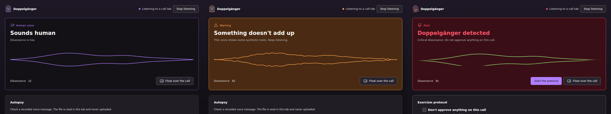

# Doppelgänger

A real-time voice-clone detector that runs on your own device. It listens to the remote side of a call in a browser tab (Google Meet, Teams web, WhatsApp Web), scores each slice of speech for signs of a synthetic or cloned voice, and shows the result as an interface that stays calm while the voice sounds human and visibly "rots" when it does not. When it detects a likely clone, it tells you what to do next: don't approve anything, ask for the agreed code word, hang up and call back on a known number.



<sub>The three alert levels, rendered by the visual tests with fixed scores.</sub>

Built with Kiro. See [How it was built with Kiro](docs/KIRO.md) and [the journal](docs/kiro-journal.md).

## Live demo

- **App:** [brennocm.github.io/doppelganger/app/](https://brennocm.github.io/doppelganger/app/)
- **Landing page:** [brennocm.github.io/doppelganger](https://brennocm.github.io/doppelganger/)

The app runs [AASIST-L](https://github.com/clovaai/aasist), a small public anti-spoofing model (MIT), in the browser. It was trained on studio recordings and has not been measured on call audio, and the app says so on screen. See [Limitations](#limitations).

## Delivery tiers

In every tier, no audio, transcript or score is sent to a remote host, and audio is never written to disk. See [ADR 0002](docs/adr/0002-browser-first-inference.md) and [ADR 0003](docs/adr/0003-delivery-tiers.md).

| Tier | What it is | Where audio is processed |
| --- | --- | --- |
| 1. Demo | The static app on GitHub Pages. Nothing to install. | In your browser (ONNX Runtime Web in a Web Worker) |
| 2. Self-hosted | The same static build, served from your own machine on `127.0.0.1`. Works offline. | In your browser |
| 3. Pro engine (optional) | A hardened Docker container with a heavier model and Autopsy (analyze a recorded file), published only on `127.0.0.1` | On your machine, in the container |

### 1. Demo

Open the [app](https://brennocm.github.io/doppelganger/app/) in a Chromium-based browser and choose a call tab or the microphone. After the first visit it also works offline.

### 2. Self-hosted and 3. Pro engine

[`scripts/install.sh`](scripts/install.sh) downloads a release, verifies every file against `SHA256SUMS`, and starts it on `127.0.0.1`. It runs on Linux and WSL2 (macOS is untested), never uses `sudo`, and writes only to `${XDG_DATA_HOME:-~/.local/share}/doppelganger` and its own Compose project.

```sh
scripts/install.sh --static     # tier 2: serve the web app with python3
scripts/install.sh              # tier 3: build and start the engine with Docker Compose
scripts/install.sh --status     # or --stop, or --uninstall
```

The installer downloads a GitHub Release. Releases are built by [`release.yml`](.github/workflows/release.yml) from a `v*` tag, with the models in [`release/models/`](release/models/).

## Limitations

- **The score is probabilistic.** It is a calibrated *dissonance score*, an estimate that a voice is synthetic. It is not proof, accuracy or certainty, and it never identifies who is speaking.
- **Not evaluated on calls.** The models are pretrained public checkpoints, used as published. They have not been evaluated on call audio, codecs or the author's own recordings, so this project publishes no accuracy numbers for them. Any future number comes from a reproducible `mise run model:eval` run, with its date and dataset named in the [model card](docs/model-card.md).
- **No replay clips.** The app bundles no labelled replay clips; use a call tab or the microphone.
- **Expected weak spots:** codec compression on calls and voice notes, background noise, accents and languages missing from the training data, short utterances, and voice-cloning systems the model has never seen.
- **Browser support.** Capturing a tab's audio and the floating widget (Document Picture-in-Picture) need a Chromium-based browser; other browsers get a compact mode. The end-to-end tests run on Chromium only.
- **A detector does not replace a verification habit.** Use it together with a code word and call-backs on known numbers.

## Develop

Requirements: Linux or Windows with WSL2, plus [mise](https://mise.jdx.dev/). mise installs the pinned Node, pnpm, Python, uv and the other tools listed in [ADR 0001](docs/adr/0001-stack.md). Docker is needed only for the Pro engine.

```sh
git clone https://github.com/brennocm/doppelganger.git
cd doppelganger
mise trust
mise install            # toolchain + git hooks
mise run check          # definition of done: format, lint, types, boundaries, tests
mise run build:pages    # builds dist/pages (landing at /, app at /app/)
python3 -m http.server 8788 --bind 127.0.0.1 --directory dist/pages
```

Then open `http://127.0.0.1:8788/`.

| Command | What it does |
| --- | --- |
| `mise run check` | Format check, lint, typecheck, boundary rules, unit and property tests |
| `mise run check:all` | `check` plus the full-history secret scan, dependency and license audit, Pages build and the end-to-end suites (CI runs this) |
| `mise run fix` | Apply every auto-fix |
| `mise run test -- <package>` | Tests for one package, for example `mise run test -- packages/detector` |
| `mise run build:pages` | Build the Pages artifact; set `PAGES_BASE=/doppelganger/` for the GitHub Pages project site |
| `mise run model:eval`, `mise run model:export` | Evaluate and export candidate models ([`packages/model-lab`](packages/model-lab/)) |
| `scripts/release-check.sh` | The release check: public URLs, license, `.kiro/`, secrets, and no pending placeholders |

## Repository layout

`apps/` holds the web app, the landing page and the Pro engine. `packages/` holds the detector logic, shared contracts, design tokens, the model lab and the MCP server. [`powers/doppelganger/`](powers/doppelganger/) is the Kiro power. Specs live in [`.kiro/specs/`](.kiro/specs/) and decisions in [`docs/adr/`](docs/adr/).

## Ethics

Voice clones used for testing or the demo are made only from the author's own voice, with consent, and are labelled as synthetic. This repository contains no voice-cloning code, prompts or models.

## License

[MIT](LICENSE). Model weights and datasets keep their own licenses (see the [model card](docs/model-card.md) and [ADR 0004](docs/adr/0004-license.md)).
